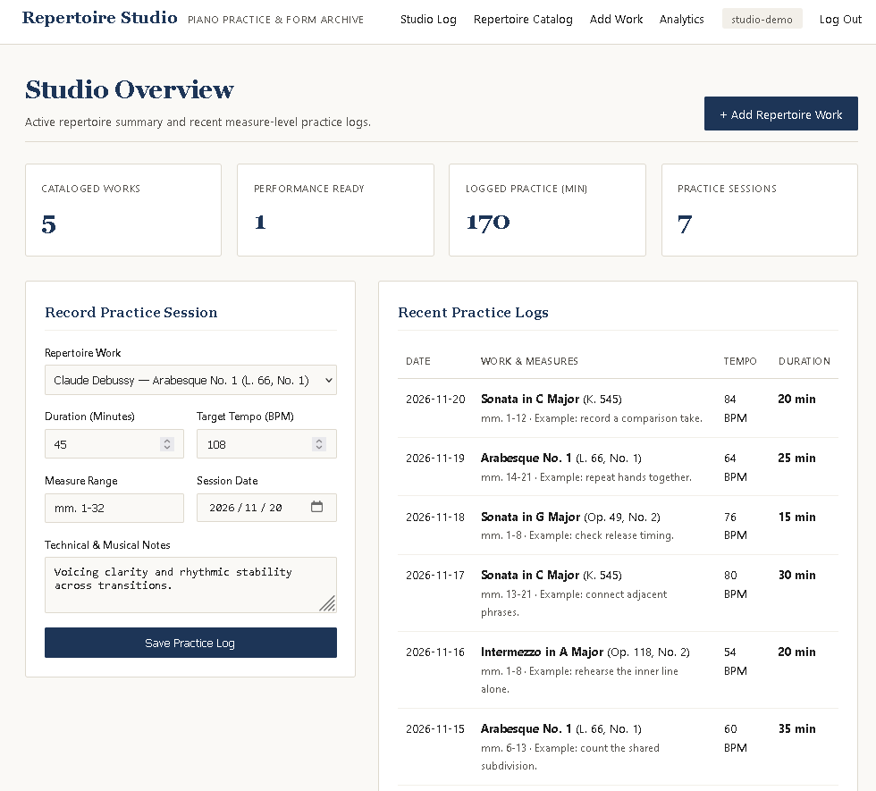
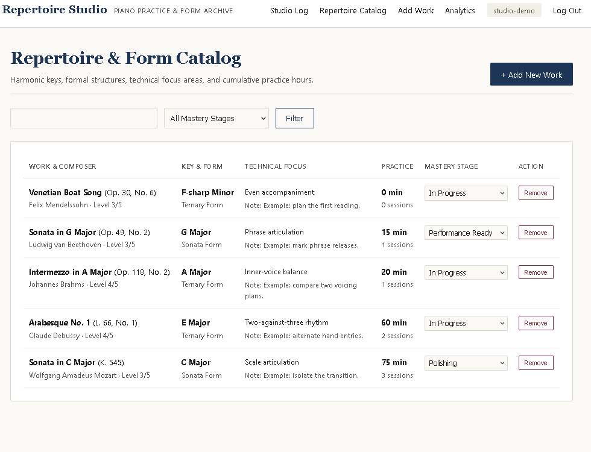
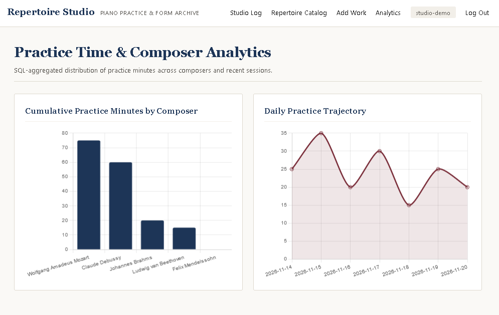

# Repertoire Studio

Repertoire Studio is a Flask application for cataloging classical piano works, recording practice sessions, and reviewing practice time. The catalog records key, form, difficulty, and technical focus. Session records link a work to a date, duration, a measure range, a target tempo, and a practice note.

I built the project from a pianist's workflow. A 45-minute practice log becomes useful for the next session when it records which measures I worked on and the tempo I was aiming for.

## Run the synthetic demo

Python 3.10 or later is required by the application's type annotations. The revision was checked with Python 3.13.17, SQLite 3.50.4, Flask 3.1.3, Werkzeug 3.1.9, and pytest 9.2.0.

```powershell
python -m pip install -r requirements.txt
python demo.py
```

Open <http://127.0.0.1:5000> and use the prefilled demo sign-in. The launcher binds to loopback with debugging disabled and generates a fresh signing key. It creates a separate temporary database containing five sample works and seven synthetic sessions. Exit normally with Ctrl+C to discard that database. The launcher leaves any existing `repertoire.db` alone. Chart.js 4.4.3 is loaded from jsDelivr, so the charts require access to that CDN.

## Interface Preview

The disposable demo contains five sample works and seven synthetic practice sessions totaling 170 minutes. The screenshots show the local workflow for logging a session, browsing the repertoire, and reviewing logged practice time. The daily chart displays the earliest 14 dates with entries and skips dates without logs.







## Run the original local studio

```powershell
python -m flask --app app run
```

This entry point still uses `repertoire.db` at the project root. On a missing database path, Flask applies `schema.sql` and inserts the original first-run examples. You can sign in with the example account shown on the local landing page or create a separate account.

For a first walkthrough, run `python demo.py`. Use the original entry point for local work with `repertoire.db`. It retains built-in example credentials and a development signing-key fallback. Treat the original examples as unverified for publication until their provenance is confirmed. Store personal practice data and snapshots outside the public repository. The schema contains destructive reset statements and is intended for a newly created database. An existing empty file will not be initialized by the current startup check.

Run tests from an isolated checkout so module import uses a disposable default database.

```powershell
python -m pytest
```

## Data model

| Table | Grain | Main fields |
|---|---|---|
| `users` | One account | Unique username and password hash |
| `pieces` | One work in an account's catalog | Composer, catalog number, key, form, technical focus, difficulty, mastery stage, notes |
| `practice_logs` | One dated practice session on one work | Duration, target BPM, measure range, notes |

Werkzeug hashes passwords. Flask signs the session cookie, and the server loads the current user from SQLite. Route queries bind user input as SQL parameters and scope reads and writes to the authenticated user where applicable. The application context owns the SQLite connection and teardown closes it. Connections enable foreign keys. Deleting a work cascades to its sessions. The practice write path checks that the selected work belongs to the signed-in account before inserting.

## From practice log to chart

The dashboard shows work counts, total minutes, and recent sessions. The catalog supports server-side status and keyword filtering and browser-side filtering within the returned rows. The two filters have different scopes. The browser matches the full rendered row text, and the server uses a fixed set of columns.

The catalog and composer totals use left joins so works with no logged minutes remain visible in the relevant results. The authenticated `/api/analytics-data` endpoint returns three series.

| JSON key | Measure | Current presentation |
|---|---|---|
| `composers` | Summed practice minutes grouped by stored composer label | Bar chart |
| `daily` | Total minutes on the earliest 14 dates with practice records. Dates without entries are skipped. | Line chart |
| `forms` | Number of catalog works grouped by stored form label | Available in the API |

Jinja renders the page and its canvases. The browser fetches the aggregated JSON and passes labels and values to Chart.js. Composer and form labels are grouped as entered. Minutes describe logged effort, target BPM is a practice goal, and mastery stages are self-reported.

## Current validation boundaries

- Browser controls guide form entry. The registration route checks password presence and confirmation, while the template also sets a minimum length. The database handles username uniqueness.
- The add-work route applies defaults to a blank catalog number, blank technical focus, or non-integer difficulty. The status-update route checks the three supported mastery stages.
- Practice logging checks positive numbers and work ownership. The browser suggests a narrower minutes and BPM range. Dates supplied outside the browser need to follow ISO calendar-date format for chronological ordering.
- The foreign keys check the account and work separately. Imports must check that each session account owns its work. The application's practice route already performs that check before writing.
- Guest requests to the analytics endpoint follow the same login redirect as guest page requests. The chart loader expects JSON from an active session.

## Project layout

- `app.py` contains the Flask factory, routes, and SQL.
- `schema.sql` defines account, catalog, and practice tables.
- `demo.py` starts the isolated local demo. `demo_seed.py` supplies the synthetic records.
- `templates/` contains the base layout and six page templates.
- `static/` contains the stylesheet and JavaScript for filtering and charts.
- `tests/test_app.py` checks the local workflow, access boundaries, and aggregation.

## Deployment scope

SQLite and explicit SQL make the data flow inspectable at personal-studio scale. Concurrent writes, migrations, startup recovery, CSRF protection, and production session settings require separate work before hosting a shared instance. The test suite exercises the current behavior, including the observed-date window. Performance changes should be checked with query plans and result comparisons on synthetic data.

For a shared deployment, configure an independent `FLASK_SECRET_KEY`, run with debugging disabled, and set HTTPS cookie options. The built-in development server is for local use. Before sharing screenshots or videos, verify they came from the disposable studio and review account names, record contents, browser details, and image metadata.
